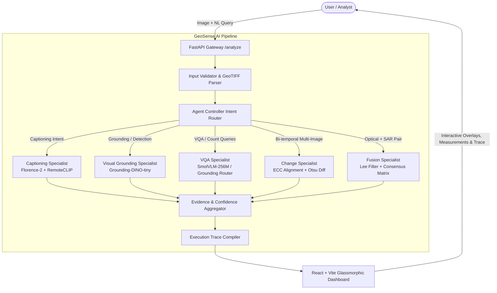

# GeoSense AI (SatQuery AI)
### Multimodal Remote Sensing Vision-Language Intelligence System
**Smart India Hackathon (SIH 2026) • Problem Statement ID: SIH26167**  
**Team: VoiceTheftAuto** • **Target Hardware: CPU-First Deployment (Intel Core i7-14650HX / Standard Cloud Nodes)**

---

## 1. Executive Summary

Earth Observation (EO) satellites produce massive volumes of high-resolution optical and Synthetic Aperture Radar (SAR) imagery daily. However, extracting actionable domain intelligence currently requires specialized GIS tools, manual interpretation by human analysts, and disconnected algorithms for detection, change analysis, and sensor fusion.

**GeoSense AI** solves this bottleneck by providing an end-to-end, multimodal Vision-Language Assistant. Analysts, disaster response coordinators, and urban planners can query remote-sensing imagery in natural language (e.g., *"What changed between these images? Highlight inundated areas"*, or *"Fuse this cloudy optical image with SAR to identify industrial buildings"*). The system automatically validates inputs, routes queries to specialized computer vision and deep learning engines, aggregates multimodal evidence, and returns **grounded responses accompanied by honest, un-fabricated confidence scores and a full multi-stage execution trace**.

---

## 2. Key Capabilities & Problem Statement Matrix

| Problem Requirement (SIH26167) | GeoSense AI Implementation | Target Latency (CPU) |
| :--- | :--- | :--- |
| **Natural Language Remote Sensing Q&A** | Specialist VQA Engine routing count/presence to Grounding-DINO and open-ended queries to SmolVLM-256M-Instruct. | 0.8s – 2.5s |
| **Detailed Scene Captioning & Land-Cover** | Florence-2 `<DETAILED_CAPTION>` fused with RemoteCLIP zero-shot scene classification and SegFormer land-cover validation. | 1.1s – 1.8s |
| **Open-Vocabulary Visual Grounding** | Grounding-DINO text-prompted spatial detection returning pixel bounding boxes, ground coordinates ($m^2$), and CRS georeferencing. | 1.2s – 2.0s |
| **Bi-Temporal Change Analysis** | Enhanced Correlation Coefficient (ECC) affine alignment, radiometric histogram matching, and Otsu difference thresholding. | 0.6s – 1.2s |
| **Optical–SAR Sensor Fusion** | Sentinel-1 Lee speckle-filtered SAR backscatter fused with Sentinel-2 optical spectral indices (NDVI/NDWI) for cloud penetration. | 0.5s – 1.0s |
| **Transparent Confidence Reporting** | Strict anti-hallucination policy: detector logits, Otsu separability metrics, or explicit *"Confidence unavailable from model"*. | < 1 ms |
| **Multi-Stage Execution Auditing** | Step-by-step pipeline logging: `INPUT` ➔ `VALIDATION` ➔ `CLASSIFICATION` ➔ `ROUTING` ➔ `INFERENCE` ➔ `EVIDENCE` ➔ `RESPONSE`. | < 1 ms |

---

## 3. System Architecture



---

## 4. Hardware Optimization & CPU-First Architecture

Modern large vision models (e.g. standard 7B/14B parameter VLMs) require expensive GPUs (24GB+ VRAM), making local edge deployment impossible for disaster response units or budget-constrained organizations.

GeoSense AI is engineered specifically for **high-throughput CPU execution**:
1. **Model Selection**: Lightweight, high-efficiency models (SmolVLM-256M, Florence-2-base, Grounding-DINO-tiny, SegFormer-B0).
2. **PyTorch Intra-Op Parallelism**: Automatically tuned to host core count (`TORCH_THREADS=16` on Intel i7-14650HX).
3. **Dynamic Memory Throttling (LRU Eviction)**: At most `MAX_LOADED_MODELS=2` heavy models reside in RAM simultaneously. Idle models are cleanly garbage collected.
4. **Zero-Code GPU Upgrade**: Setting `DEVICE=auto` detects NVIDIA CUDA GPUs if present; otherwise, it seamlessly falls back to CPU without modifying any application code.

---

## 5. Model Registry & Selection Rationale

All models are declaratively defined in `models/registry.yaml`:

```yaml
models:
  florence-2-base:
    name: Florence-2-base
    backend: transformers
    kind: ml
    size_mb: 460
    provides_scores: false
    tasks: [captioning, grounding]
    
  remoteclip-vit-b-32:
    name: RemoteCLIP ViT-B-32
    backend: open_clip
    kind: ml
    size_mb: 350
    provides_scores: true
    tasks: [classification, captioning_cross_check]

  grounding-dino-tiny:
    name: Grounding-DINO-tiny
    backend: transformers
    kind: ml
    size_mb: 340
    provides_scores: true
    tasks: [grounding, vqa_count]

  smolvlm-256m:
    name: SmolVLM-256M-Instruct
    backend: transformers
    kind: ml
    size_mb: 512
    provides_scores: false
    tasks: [vqa_open_ended]

  bitemporal-ecc-otsu:
    name: Bi-Temporal ECC & Otsu Engine
    backend: opencv_scipy
    kind: algorithm
    size_mb: 0
    provides_scores: true
    tasks: [change_analysis]

  optical-sar-consensus:
    name: Optical-SAR Multimodal Fusion
    backend: rasterio_numpy
    kind: algorithm
    size_mb: 0
    provides_scores: true
    tasks: [optical_sar_fusion]
```

---

## 6. Transparent Confidence Scoring Policy

**Core Rule: Never fabricate or hallucinate confidence scores.**
- **Model-Emitted**: Genuine detection sigmoid scores from Grounding-DINO (`kind: model, calibrated: false`).
- **Algorithmically Estimated**: Otsu between-class variance separability metric $\eta = \sigma_B^2 / \sigma_T^2$ for change detection, or multi-sensor agreement rate for SAR-optical consensus (`kind: estimated`).
- **Explicitly Unavailable**: Autoregressive text generation from SmolVLM or Florence-2 does not emit well-calibrated confidence scores. GeoSense AI transparently flags these as `Confidence: Unavailable from model` (`kind: unavailable`) instead of inventing random numbers.

---

## 7. Specialist Engines Overview

### 1. Scene Captioning Specialist (`CaptioningSpecialist`)
- **Pipeline**: Prompts Florence-2 with `<DETAILED_CAPTION>`. Concurrently computes RemoteCLIP zero-shot similarity against 45 Earth Observation scene classes (NWPU-RESISC45 ontology).
- **Cross-Validation**: If Florence-2 omits prominent features detected by RemoteCLIP (e.g. *harbor*, *runway*), the evidence aggregator synthesizes a balanced, verified caption.

### 2. Visual Grounding Specialist (`GroundingSpecialist`)
- **Pipeline**: Accepts natural-language target phrases (e.g. *"all residential buildings"*, *"fuel storage tanks"*).
- **Output**: Pixel bounding boxes `[x0, y0, x1, y1]`, class confidence logits, and georeferenced bounding coordinates (UTM or WGS84) with physical area measurements ($m^2$).

### 3. Visual Question Answering Specialist (`VQASpecialist`)
- **Query Classification**:
  - `COUNT` queries (*"How many airplanes are parked?"*) ➔ Routed to Grounding engine for precise spatial object isolation.
  - `PRESENCE` queries (*"Is there a runway visible?"*) ➔ Routed to RemoteCLIP zero-shot verification.
  - `OPEN-ENDED` queries (*"What is the general condition of the coastline?"*) ➔ Routed to SmolVLM-256M.

### 4. Bi-Temporal Change Detection (`ChangeSpecialist`)
- **Registration**: Enhanced Correlation Coefficient (ECC) affine alignment corrects sub-pixel misregistration between $T_1$ and $T_2$.
- **Equalization**: Histogram matching harmonizes atmospheric and seasonal illumination differences.
- **Segmentation**: CIE $L^*a^*b^*$ Euclidean distance + directional Sobel gradients followed by Otsu optimal thresholding. Connected components filter out high-frequency noise.

### 5. Optical–SAR Sensor Fusion (`FusionSpecialist`)
- **Radar Preprocessing**: Converts raw Digital Number (DN) SAR amplitudes to decibel ($\text{dB}$) scale and applies a 5x5 Lee speckle filter.
- **Multimodal Consensus**: Evaluates optical Normalized Difference Water Index (NDWI) against low SAR backscatter (calm water specular reflection) to achieve reliable cloud-penetrating water mapping.

---

## 8. Training Architecture (Non-Startup Fine-Tuning)

Located in `training/`, independent of runtime inference:
- `training/captioning/`: LoRA/PEFT scripts for fine-tuning Florence-2 / RemoteCLIP on RSICD and NWPU datasets.
- `training/grounding/`: Open-vocabulary detection fine-tuning for Grounding-DINO on DIOR and SpaceNet.

---

## 9. Quickstart & Local Setup

### Prerequisites
- Python 3.10.x (64-bit)
- Node.js 18+ and npm
- Git

### 1. Clone & Set Up Backend
```bash
git clone https://github.com/VoiceTheftAuto/GeoSense-AI.git
cd GeoSense-AI

# Create virtual environment
python -m venv backend/.venv
.\backend\.venv\Scripts\Activate.ps1  # Windows PowerShell
# source backend/.venv/bin/activate    # Linux / macOS

# Install dependencies (CPU PyTorch)
pip install torch torchvision --index-url https://download.pytorch.org/whl/cpu
pip install -r backend/requirements.txt
```

### 2. Set Up Frontend
```bash
cd frontend
npm install
npm run build
cd ..
```

### 3. Run Application
```bash
# Start backend server (serves API on :8000 and the built React frontend)
$env:PYTHONPATH="backend"
python -m uvicorn app.main:app --host 127.0.0.1 --port 8000
```
Open **`http://127.0.0.1:8000`** in your browser.

---

## 10. Docker Deployment

Deploy with a single command using Docker Compose:

```bash
docker compose up --build
```
The application will be accessible at `http://localhost:8000`.

---

## 11. Automated Test Suite

GeoSense AI contains 66 comprehensive automated test cases validating validators, controller routing, specialist engines, and API endpoints:

```bash
$env:PYTHONPATH="backend"
pytest backend/tests -v
```

**Test Verification Summary**:
```text
============================= test session starts =============================
collected 66 items

backend/tests/test_controller.py ...........                             [ 16%]
backend/tests/test_core.py .......                                       [ 27%]
backend/tests/test_routing.py ..................                         [ 54%]
backend/tests/test_specialists.py ........                               [ 66%]
backend/tests/test_validation.py ......................                  [100%]

====================== 66 passed, 22 warnings in 12.58s =======================
```

---

## 12. API Reference

| Method | Endpoint | Description |
| :--- | :--- | :--- |
| `GET` | `/health` | Hardware telemetry, device resolution, loaded models, demo mode status. |
| `GET` | `/models` | Complete model registry with license, size, backends, and status. |
| `POST` | `/upload` | Ingests 1–2 satellite images; parses affine transforms, GSD, and CRS. |
| `POST` | `/validate` | Pre-flight validation report without throwing 500 errors. |
| `POST` | `/analyze` | Main endpoint: accepts query + imagery, returns answers, confidence, layers, and trace. |
| `GET` | `/files/{file_id}` | Serves dynamically generated masks, difference maps, and composite overlays. |

---

## 13. Team & Acknowledgements

- **Team**: VoiceTheftAuto
- **Event**: Smart India Hackathon (SIH 2026)
- **Problem Statement**: SIH26167 — *SatQuery AI: Vision-Language Assistant for Multimodal Remote Sensing Analysis*
- **License**: MIT Permissive License
